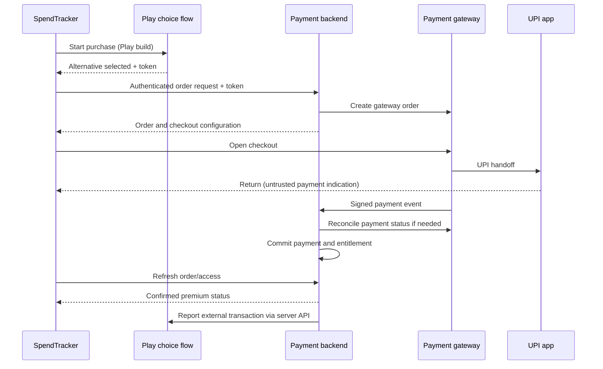

# Custom paywall and UPI payments: feasibility and implementation approach

Assessment date: 28 September 2026. Scope: repository review and implementation proposal; no payment integration or live transactions performed.

## Decision

**Technically feasible, with a distribution constraint.** SpendTracker already owns its paywall UI. The proposed work changes the checkout and entitlement system behind it.

For the assumed launch channel—Google Play, Indian mobile/tablet users—recommend **custom paywall → Play user-choice flow → payment gateway → installed UPI app → server-confirmed premium access**. India's alternative billing program requires Play Billing alongside the alternative, enrollment, transaction reporting within 24 hours of authorization, and an adjusted Play service fee. It does not permit simply replacing Play Billing with a UPI button. [Google's India program](https://support.google.com/googleplay/android-developer/answer/13306652?hl=en).

If eliminating Play Billing is a firm requirement, evaluate a separately distributed direct-install Android build. That adds distribution, updates, signing, support, and acquisition work; each other store has its own rules. Do not use a remotely enabled UPI bypass inside the Play build.

Assumptions: payments unlock SpendTracker's digital premium features; India is the initial market; prices and merchant/provider accounts are not yet confirmed. The app tracks payments but the purchase being sold is digital app access, not a physical service. Google's digital-purchase rules therefore apply to this proposal. [Payments policy](https://support.google.com/googleplay/android-developer/answer/9858738?hl=en).

## What exists in this repository

Paths below are relative to the repository root. Findings reflect the working tree inspected, including existing uncommitted work.

| Existing component | Finding and implication |
|---|---|
| `app/src/main/res/layout/fragment_paywall.xml` and `ui/premium/PaywallFragment.java` | Custom benefits, plan selection, continue, and restore UI already exist. Extend these rather than replace the screen architecture. |
| `billing/BillingManager.java` | Owns Play connection, product queries, purchase launch, restore, and acknowledgment. Keep it as the Play checkout adapter. |
| `billing/PremiumRepository.java` | Central access API, but directly coupled to Play. It currently writes successful subscription access with `expiresAt = 0`. |
| `billing/LocalPurchaseVerifier.java` | Checks purchase state and product membership only; it does not perform authoritative backend verification. |
| `billing/EntitlementCache.java` and `PremiumState.java` | Encrypted local cache; subscription fallback lasts three days after local verification when expiry is absent. Lifetime access is accepted without a freshness bound. |
| `ui/premium/FeatureGate.java` | Allows features when the store is unconfigured. Removing Play product IDs would currently bypass gating, not safely switch payment providers. |
| `app/src/main/res/values/billing_products.xml` | Monthly, yearly, and lifetime IDs are blank, so the current store is unconfigured. |
| `gradle/libs.versions.toml` | Play Billing dependency is declared as 9.1.0. Check the selected gateway SDK against the actual build during implementation. |
| `util/DriveBackupClient.java`, `ui/settings/BackupViewModel.java` | Google sign-in supports Drive backup; this is not an implemented payment-account backend. |

Java paths above are under `app/src/main/java/com/example/spendtracker/`. No payment backend, gateway order service, or webhook receiver was identified in the inspected project. Existing billing coverage includes `PremiumStateTest` and `FeatureGateTest`; neither demonstrates a live purchase flow.

## Options and feasibility

| Option | Assessment | Recommendation |
|---|---|---|
| Existing custom UI with Play checkout | Smallest change; checkout payment methods remain controlled by Play | Retain as the baseline/fallback |
| Custom UI plus enrolled alternative billing and gateway UPI | Feasible with backend, merchant onboarding, and operational support | Recommended Play route |
| Only a direct UPI button in the Play app | Not supported by the India route assessed above | Do not implement as a bypass |
| Separate non-Play build using gateway UPI | Technically feasible, subject to its distribution terms | Consider only if removing Play is essential |
| Raw `upi://pay` transfer to a personal VPA, trusting the return result | Easy prototype; inadequate automated proof of payment, restore, refunds, and reconciliation | Reject for production entitlement grants |

UPI app redirection and redirecting users to an external purchase website are different designs. This proposal uses a gateway's Android checkout and UPI handoff inside the permitted alternative billing flow. Do not infer permission for arbitrary browser checkout links from another region's external-offers program.

## Recommended product scope

Use **Razorpay's Android Standard Checkout as the first proof-of-concept candidate**, conditional on merchant acceptance, commercial terms, and successful device testing. Its Android documentation provides order integration, UPI support, server signature verification, and payment status checks. This is a starting choice, not a claim that it has the lowest fees. [Android integration](https://razorpay.com/docs/payments/payment-gateway/android-integration/standard/integration-steps/).

Own the benefits, plan cards, pricing explanation, and purchase status screen. Initially let the gateway own the UPI app chooser. A fully custom branded app chooser would require separate assessment of the provider's custom checkout capabilities and approval; do not promise it based on Standard Checkout.

Start with one approved one-time product: preferably a fixed-term annual pass with an explicit end date, or lifetime if commercially intended. Label fixed-term access as prepaid and non-renewing. Do not describe a normal UPI payment as an automatically renewing subscription.

Monthly/yearly automatic renewal requires a separate UPI AutoPay mandate and lifecycle. Razorpay offers AutoPay; exact merchant enablement, supported banks/apps, limits, notifications, cancellation, and pricing must be confirmed for the selected integration. Add this after one-time checkout is reliable. [UPI AutoPay](https://razorpay.com/upi-autopay/).

Google Pay can remain an available UPI app: Google Pay and Google Play Billing are distinct products.

## Purchase experience

1. Show premium benefits, full price, duration, renewal terms, restore access, support, and refund links. Never invent prices when the catalog is unavailable.
2. Establish a recoverable premium account before starting alternative checkout. Proposed default: verified email sign-in, with local expense tracking still usable without an account. Drive backup permission must not become a purchase prerequisite.
3. For the Play build, launch the supported user-choice API. Google handles country eligibility and the choice screen; phone locale, SIM country, and IP alone are not authorization. Enable `enableUserChoiceBilling`, handle `UserChoiceBillingListener`, and persist the returned external transaction token on the server before gateway checkout. Keep the normal Play result path. [Client integration](https://developer.android.com/google/play/billing/alternative/alternative-billing-with-user-choice-in-app).
4. Server creates an order tied to the authenticated account and selected catalog version. It fixes amount, currency, product, and validity; the app cannot choose the payable amount.
5. Gateway checkout launches an available UPI app. A missing app or failed handoff shows an actionable retry/alternative method; it never grants access.
6. On return, show “Checking payment”. A callback, deep link, screenshot, UTR entry, or parsed bank SMS is not proof of entitlement.
7. Server validates provider evidence and confirms the matching captured payment. App refreshes access and displays a receipt/reference and expiry where applicable.
8. If confirmation is delayed, show “Payment pending—check status” and recover the same order after relaunch. Do not immediately encourage a second payment.

The diagram shows the alternative branch only. Play purchases keep their own verification and acknowledgment flow. A user returning to the app is not required for a webhook to complete an order.

## Backend and entitlement design

This section is a proposed design, not an existing service.

Build a small authenticated HTTPS service with a transactional database and durable background jobs. Hosting/provider selection is open. Suggested contract:

| Endpoint | Responsibility |
|---|---|
| `GET /v1/catalog` | Versioned plans, amounts, durations, available checkout routes |
| `POST /v1/orders` | Validate account, catalog, eligibility and idempotency key; create provider order |
| `POST /v1/orders/{id}/verify` | Accept callback evidence and verify against server-owned order; never accept a client success flag |
| `GET /v1/orders/{id}` | Return status only to its owner; request bounded reconciliation when stale |
| `GET /v1/me/entitlements` | Canonical access, source, expiry, and offline lease |
| `POST /v1/webhooks/{provider}` | Authenticate provider events, durably ingest, deduplicate and process |
| `POST /v1/play/purchases/verify` | Validate Play token and ownership with Google; normalize into the same access model |

Persist accounts, catalog versions, orders, payments, subscriptions when added, entitlement grants, webhook events, refunds, and a reporting outbox. Store monetary values in integer minor units. Keep provider payment IDs unique, and bind each order to one account. Use a database transaction to record a confirmed payment, its access grant, and reporting work exactly once.

For the Razorpay candidate, verify checkout signatures on the backend using the stored order ID and secret; require the correct amount, currency, merchant and captured status before access. Keep secrets out of the APK. [Verification steps](https://razorpay.com/docs/payments/payment-gateway/android-integration/standard/integration-steps/).

Validate webhook signatures over the original request body. Deduplicate event IDs and tolerate events arriving out of order. Persist before acknowledging delivery; periodically reconcile unresolved orders through provider APIs. [Webhook validation](https://razorpay.com/docs/webhooks/validate-test/).

Use separate payment and access states. Proposed payment states: `CREATED`, `PENDING`, `CAPTURED`, `FAILED`, `REFUNDED`, `PARTIALLY_REFUNDED`. Closing checkout is a UI event, not definitive payment failure. Late success must reconcile even after UI timeout. An older authorization event must not undo capture/refund state.

Maintain entitlement grants per source and aggregate valid grants. A Play restore returning no purchases must not erase a valid UPI grant. Refunds revoke or adjust only the affected grant under the published refund policy; partial refunds require an explicit rule. Subscription cancellation stops future collection but normally retains the already-paid period unless refunded.

Proposed offline policy: cache a server-issued signed access lease for up to 72 hours, capped at a fixed-term product's expiry. Apply a bounded freshness policy to lifetime access too, so refunds can eventually take effect. Refresh on resume and connectivity recovery; clock rollback must not extend access. A modified fully offline app cannot be made perfectly tamper-proof. Premium expiry must never delete or withhold users' existing expense records.

Keep expense history, bank statements, and SMS content local. Send only account and purchase metadata required for billing. Redact secrets/tokens from logs and provide account recovery, receipt access, data retention, and support procedures.

## Play reporting and existing purchasers

Use a durable reporting worker with retries, stable external transaction IDs, and alerts well before the reporting deadline. Monitor authorization time separately from capture; do not start the deadline clock when the user returns to the app. Reporting downtime must not repeatedly charge a user or undo a verified grant.

Google's backend API supports reporting the initial purchase, later renewals/top-ups linked to the initial transaction, and full or partial refunds. Store the necessary linkage and tax amounts. Do not implement a new manual-reporting workflow. [Backend integration](https://developer.android.com/google/play/billing/outside-gpb-backend).

Preserve existing Play purchasers and their management route. Verify and associate purchases with recoverable accounts using an explicit ownership/recovery process. Never silently move an active Play subscription to UPI or start a duplicate renewal. Cancel/change through its original provider; a future provider switch requires clear user consent and overlap handling.

## Repository implementation map

| Area | Proposed change |
|---|---|
| `PaywallFragment`, `PaywallViewModel`, layout | Display provider-neutral catalog and persistent checkout states; expose recovery/support actions |
| `PremiumPlan`, `PremiumPurchaseType` | Separate internal plan ID from Play/provider IDs; add prepaid fixed-term access distinct from auto-renewing subscription |
| `BillingManager` | Retain Play adapter; add user-choice callback and server verification integration |
| New checkout coordinator and gateway adapter | Route eligible checkout, handle SDK lifecycle, persist pending order, resume after process death |
| `PremiumRepository` | Read unified server entitlements; remove direct access grants based solely on device purchase result |
| `LocalPurchaseVerifier`, `PurchaseVerifier` | Replace production local-only verification with asynchronous backend validation |
| `PremiumState`, `EntitlementCache` | Store source-aware signed lease, trusted expiry, account binding and refresh metadata |
| `FeatureGate`, product configuration | Separate explicit monetization rollout policy from whether Play product IDs exist; test legacy free behavior |
| `RepositoryModule`, manifest, dependencies | Bind new services; add only gateway-required intent/package visibility configuration and return handling |
| New backend project | Authentication, catalog, payments, refunds, entitlement storage, Play verification/reporting and operations |

Do not hard-code another provider's purchase status into UI feature gates. Keep the existing central gate so this does not require rewriting every premium feature.

## Cost and delivery assessment

Alternative billing does not eliminate Play charges. The India program reduces the applicable Play rate by four percentage points; a hypothetical 15% rate becomes 11%, before gateway and operating costs. Enrollment also includes trust/safety requirements, fraud reporting, payment profile setup, and compliance declarations. Confirm these for the merchant before launch. [India requirements](https://support.google.com/googleplay/android-developer/answer/13306652?hl=en).

For planning, compare per-order proceeds as `price − Play fee − gateway charges − taxes on charges − refund/support allocation`, using the actual contractual fee bases. Add authentication, hosting, monitoring, and developer time. No merchant quote or fee tier was inspected; a savings claim would be premature.

Indicative engineering estimate for one developer familiar with the app, excluding onboarding/review waits:

| Phase | Deliverable | Estimate |
|---|---|---|
| 0 | Confirm channel, products, recovery account, gateway acceptance and Play enrollment path | 2–3 working days |
| 1 | Backend accounts, catalog, orders, verification, entitlements and reconciliation | 5–8 days |
| 2 | Android paywall adaptation, user choice, UPI handoff and recovery | 4–6 days |
| 3 | Reporting/refunds, device tests, failure handling and limited rollout | 4–6 days |
| Later | AutoPay mandates, renewals, cancellation, dunning and lifecycle tests | Additional 5–10 days |

One-time production MVP: roughly 15–23 engineering days, with high uncertainty until provider access and product decisions are resolved. This includes a backend foundation missing from the current billing path.

## Validation and rollout gates

Before collecting customer payments, demonstrate:

- Valid purchase grants once; forged callbacks, wrong amounts, wrong accounts, and reused payment IDs grant nothing.
- Duplicate/out-of-order webhooks, process death, airplane mode on return, delayed success, provider timeout, and server restart recover without duplicate charges or access grants.
- Restore on reinstall/new device works; logout/account switching cannot inherit another account's cache.
- Fixed-term expiry, offline lease expiry, clock changes, full/partial refunds, Play-only users, and simultaneous grants behave correctly.
- Play eligibility and choice are exercised in enrolled test configuration; reporting, retries, and refund reporting are observable.
- Real Android devices exercise available UPI apps, no-app cases, cancellation and return behavior. Provider sandbox success alone is insufficient: Razorpay documents live mode for UPI Intent/QR testing. Plan controlled merchant-approved low-value live tests and refunds. [Testing guidance](https://razorpay.com/docs/payments/payment-gateway/android-integration/standard/integration-steps/).

Release to an enrolled internal cohort, then a small production cohort. Track checkout completion, unresolved order age, paid-without-access incidents, duplicate grants, refunds, and reporting lag. Provide a kill switch for **new alternative checkouts** while keeping verification, restore, refunds, existing access, and reporting operational.

## Decisions required before implementation

1. Confirm Google Play remains the primary channel, or choose a separate direct-distribution build.
2. Choose first product, actual price, access period, and refund terms; decide whether AutoPay is needed at launch.
3. Confirm merchant entity, settlement account, gateway onboarding and commercial terms.
4. Confirm Play enrollment, real product IDs, required declarations, and reporting credentials.
5. Choose backend hosting and recoverable account method; assign ownership for refunds, support and failed reporting.

**Proposed next implementation milestone:** a complete test purchase through user-choice checkout and UPI handoff, with server verification, cross-device restore, refund handling, and external transaction reporting. Production checkout remains disabled until the distribution and merchant prerequisites are met.
